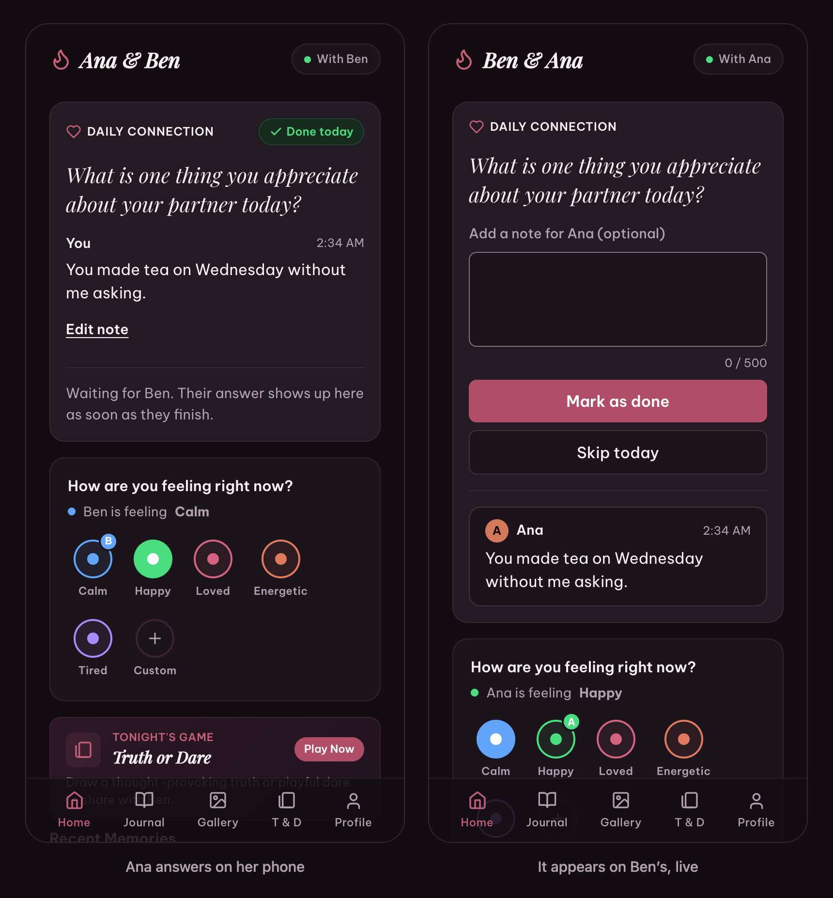
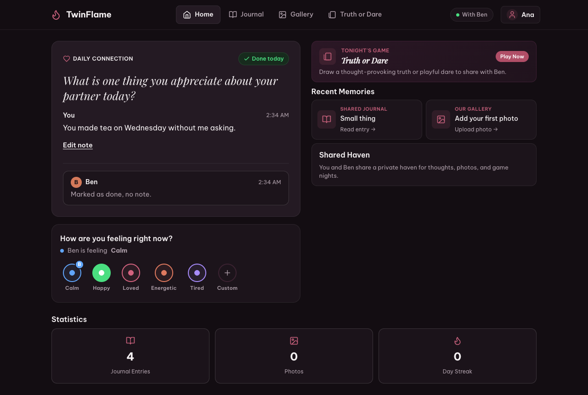
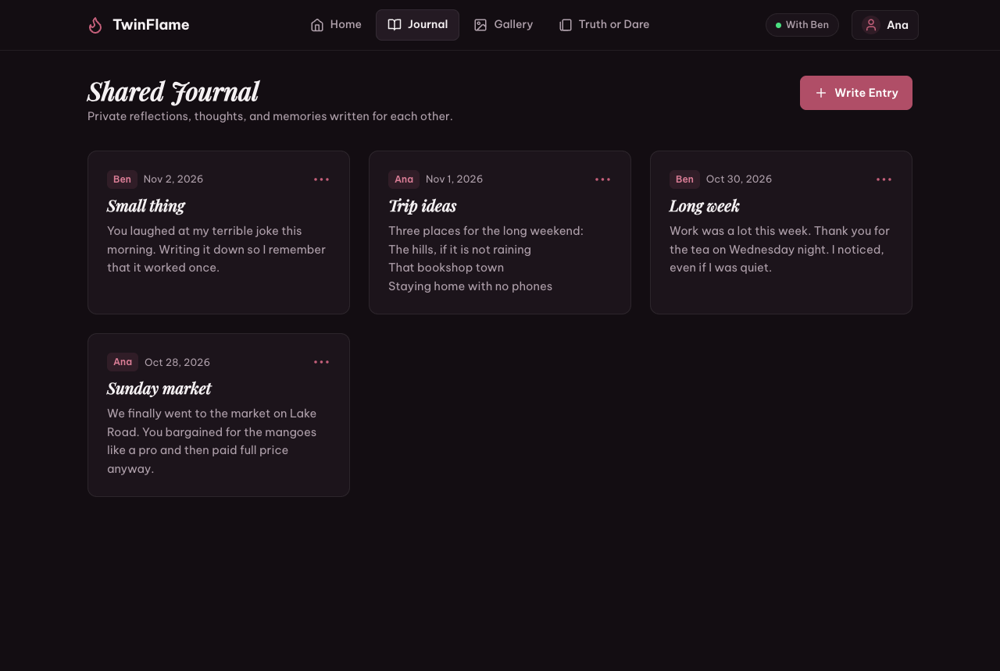
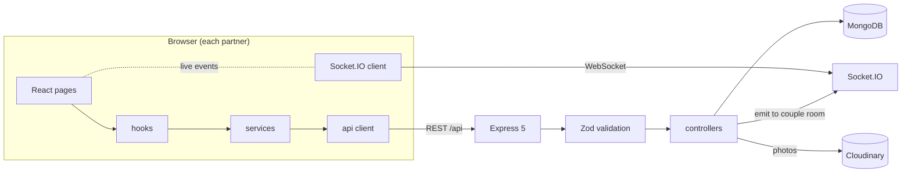

# TwinFlame

[](https://github.com/sanalnayyar2006/TwinFlame-mern/actions/workflows/ci.yml)

A private space for two people. Partners link their accounts with a code, then share a daily question, a journal, a photo gallery, and their current mood. When one partner answers or changes something, the other sees it on their screen straight away.



## Try it

**Live:** [twinflame-mern.onrender.com](https://twinflame-mern.onrender.com)

The login page has a demo couple, Ana and Ben. Open Ana in one window and Ben in a private window, answer the daily question as Ana, and watch it arrive on Ben's screen. The demo is shared by everyone and resets every 24 hours.

To run the demo locally, see [Demo mode](#demo-mode).

## Features

- **Partner linking.** Each account gets a 6-character couple code. Entering your partner's code links you. A linked account can't be claimed by anyone else.
- **Daily Connection.** One question a day, the same for both partners. Mark it done, optionally with a note, and edit the note until the day ends. Your partner's answer appears live.
- **Mood.** Pick a preset or a custom mood with a colour; your partner sees it update live.
- **Shared journal.** Rich-text entries with inline photos, drafts saved on the device, and infinite scroll.
- **Gallery.** Shared photos with captions, square thumbnails in the grid, and a full-size viewer.
- **Truth or Dare.** Random prompts for the two of you.
- **Sign-in.** Email and password, or Google.

| Dashboard | Journal |
|---|---|
|  |  |

## How it works



**Live updates.** When a socket connects, the server verifies the JWT and joins it to two rooms: one for the user and one for their couple. Controllers emit to the couple room after a write, so only the two partners receive it. Linking a partner moves both users' open sockets into the new couple room, so the other dashboard updates without a reload.

**What "today" means.** Partners in the same time zone use their local day. Partners in different time zones share the UTC day, so they always get the same question. Each browser sends its IANA time zone, and the server compares current UTC offsets (`server/src/utils/dayKey.ts`).

**Photos.** Images go to Cloudinary, one folder per couple. Removing a photo from an entry or deleting the entry deletes the file too, and cleanup only touches the couple's own folder. Lists load Cloudinary thumbnails, never originals.

**Security.**
- Every request body is validated with Zod, so objects like `{"$ne": null}` never reach a Mongo query.
- CORS only allows exact origins.
- Journal HTML is sanitized on the server before saving and again in the browser before display.
- Sign-in, registration, and uploads are rate limited, and the server sends security headers (Helmet).
- The server refuses to start in production without a strong `JWT_SECRET` and a `GOOGLE_CLIENT_ID`.

## Tech stack

| Area | Tools |
|---|---|
| Client | React 19, TypeScript, Vite, React Router 7, CSS Modules, Socket.IO client, DOMPurify |
| Server | Node.js 22, Express 5, TypeScript, Socket.IO, Mongoose, Zod, Helmet, express-rate-limit, pino |
| Data | MongoDB, Cloudinary |
| Testing | Vitest, Testing Library, Supertest, mongodb-memory-server, Playwright |
| Tooling | pnpm workspaces, ESLint, GitHub Actions |

## Getting started

**Requirements:** Node.js 22+, pnpm 10 (`npm install -g pnpm`), a MongoDB database (Atlas or local), and a Cloudinary account for photos.

```bash
git clone https://github.com/sanalnayyar2006/TwinFlame-mern.git
cd TwinFlame-mern
pnpm install

cp server/.env.example server/.env   # fill in Mongo, JWT, Cloudinary, Google
cp client/.env.example client/.env   # fill in VITE_GOOGLE_CLIENT_ID

pnpm --filter server seed            # Truth or Dare prompts
pnpm dev                             # API on :8000, app on :5173
```

Each variable is explained in [`server/.env.example`](server/.env.example) and [`client/.env.example`](client/.env.example).

### On your phone

The Vite dev server is reachable on your local network. With your phone on the same Wi-Fi, open the `Network` address Vite prints (for example `http://192.168.1.5:5173`). API and socket traffic go through the Vite proxy, so the phone only needs to reach that one address. To try two accounts on one phone, use a normal and a private tab.

### Demo mode

Set `DEMO_MODE=true` in `server/.env` and `VITE_DEMO_MODE=true` in `client/.env`, then restart. The login page shows **Enter as Ana** and **Enter as Ben**. The demo couple is created on first use and recreated once it is a day old. `pnpm --filter server seed:demo` resets it on demand.

## Testing

```bash
pnpm typecheck   # client and server, including test files
pnpm lint
pnpm test        # server API and unit tests, client component tests
pnpm test:e2e    # builds the client, then runs Playwright against the production build
```

- **Server tests** run the real Express app against an in-memory MongoDB. They cover authentication, partner linking (including injection attempts and two people racing for the same partner), journal and gallery access rules, photo cleanup, the Daily Connection, socket events, production CORS, and rate limits. Cloudinary is mocked, and `server/.env` is never read.
- **Accessibility tests** run axe-core against every screen and its menus and dialogs, on desktop and a phone-sized screen, and fail on any WCAG 2.1 AA violation.
- **End-to-end tests** open two browser contexts as two partners and check that answers, edits, and moods sync live, on a desktop and a phone-sized screen.

To skip the one-time MongoDB download locally, run tests with `MONGOMS_SYSTEM_BINARY=$(which mongod)`.

CI runs all of the above on every push to `main` and every pull request.

## Deploying

The server serves the built client, so one web service is enough. On Render:

| Setting | Value |
|---|---|
| Build command | `pnpm install --frozen-lockfile && pnpm build` |
| Start command | `pnpm start` |
| Health check path | `/health` |

Set these environment variables on the host:

| Variable | Notes |
|---|---|
| `NODE_ENV` | `production` |
| `MONGODB_URI` | Atlas connection string |
| `JWT_SECRET` | 32+ random characters (`openssl rand -hex 32`); the server won't start with less |
| `GOOGLE_CLIENT_ID` | Same as `VITE_GOOGLE_CLIENT_ID`; required |
| `VITE_GOOGLE_CLIENT_ID` | Read at build time |
| `CLOUDINARY_CLOUD_NAME`, `CLOUDINARY_API_KEY`, `CLOUDINARY_API_SECRET` | Photo storage |
| `CLIENT_URL` | Only if the client is hosted on a different origin |
| `DEMO_MODE`, `VITE_DEMO_MODE` | `true` to offer the public demo couple |

Leave `VITE_API_URL` unset when the server serves the client. Older journal entries with embedded base64 photos can be moved to Cloudinary with `pnpm --filter server migrate:journal-images` (dry run), then the same command with `--apply`.

## Project structure

```
client/          React app
  src/pages/       route screens
  src/components/  UI, including dashboard/ cards
  src/hooks/       data and behaviour (paging, sockets, sign-out)
  src/services/    API calls, one file per feature
server/          Express API and Socket.IO
  src/app.ts       app, routes, sockets (no I/O, used by tests)
  src/index.ts     connects to Mongo and listens
  src/controllers/ src/routes/ src/models/ src/validation/
  src/config/      env checks, security, logging, Cloudinary
  src/scripts/     demo seed, journal photo migration
  tests/           Vitest API and unit tests
e2e/             Playwright tests and README screenshot script
```

README screenshots come from the running app: `pnpm --filter e2e screenshots`.
